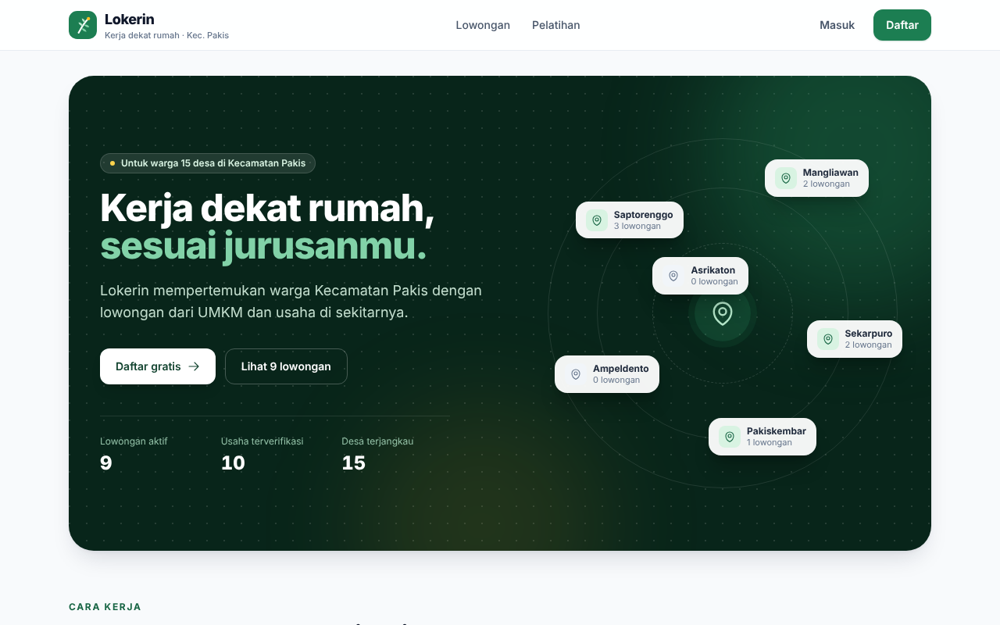
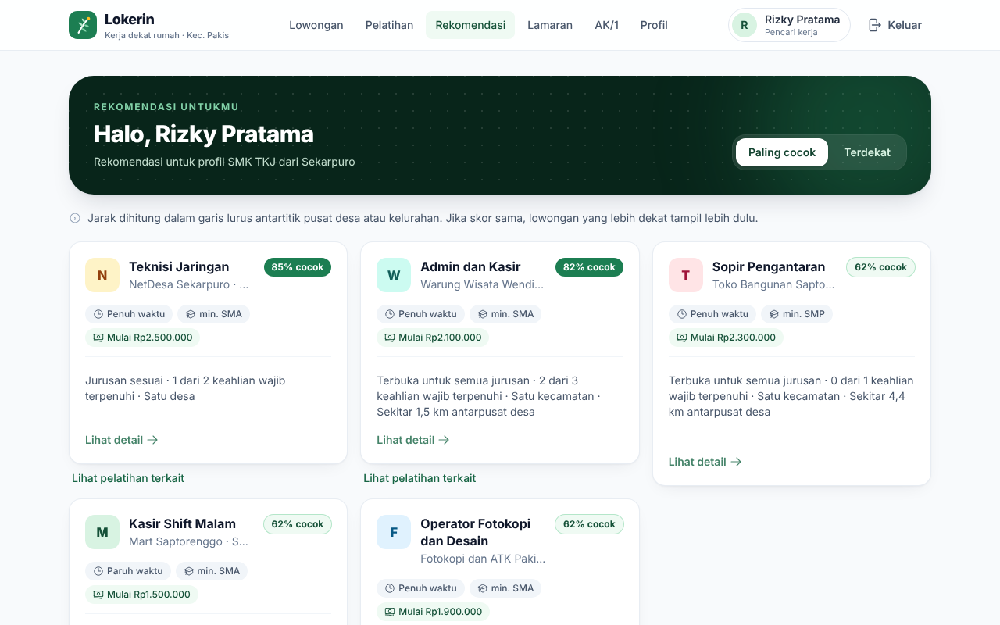
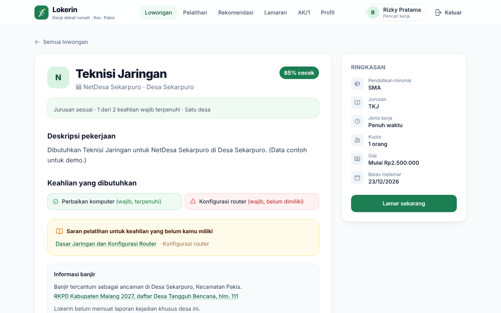
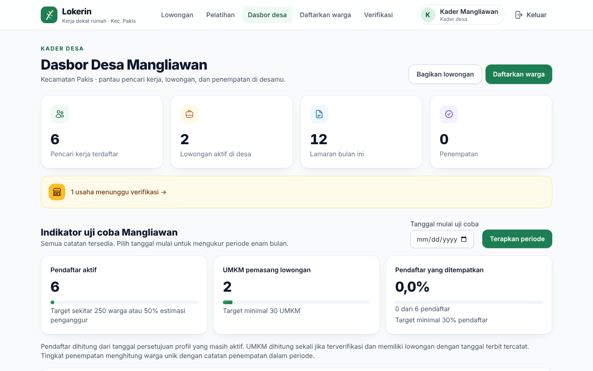
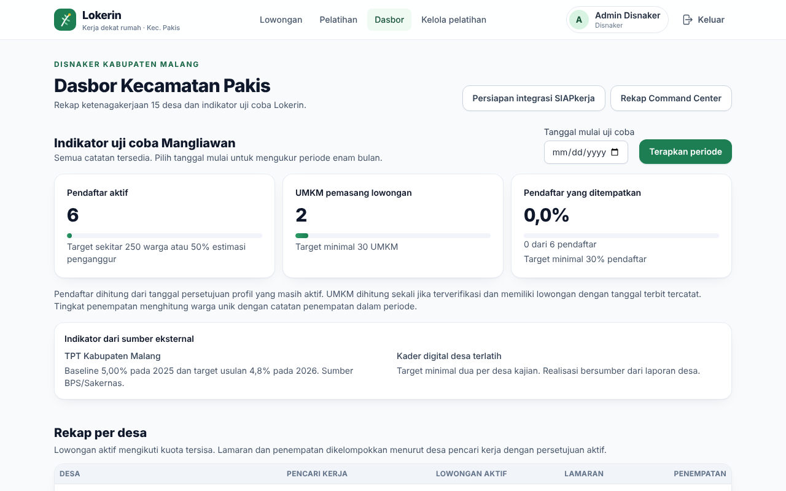
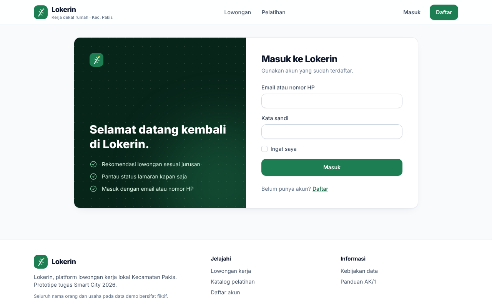
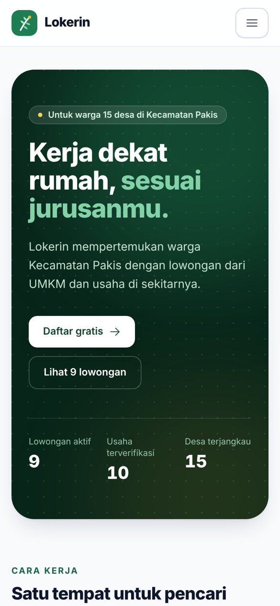

<div align="center">


# Lokerin

**Kerja dekat rumah, sesuai jurusanmu.**

Platform lowongan kerja lokal yang mempertemukan warga Kecamatan Pakis, Kabupaten Malang,<br>
dengan lowongan dari UMKM dan usaha di desa-desa sekitarnya.


[Fitur](#fitur) · [Tampilan](#tampilan) · [Coba sekarang](#coba-sekarang) · [Akun demo](#akun-demo) · [Skenario demo](#skenario-demo-5-menit) · [Tim](#tim)



</div>

---

## Tentang

Lokerin adalah prototipe tugas mata kuliah **Smart City 2026** yang menjadi gambaran awal implementasi dari *Buku I Analisis Strategis Smart City Kecamatan Pakis*. Rancangan lengkapnya ada di dokumen **Rancangan_Lokerin.docx**.

**Masalah.** Tingkat Pengangguran Terbuka Kabupaten Malang masih 5,00% pada 2025, di atas rata-rata nasional. Penganggur didominasi lulusan SMK (TPT 9,93%) dan kelompok usia 15-24 tahun (60,12% penganggur). Di Pakis, informasi lowongan dari UMKM sekitar tersebar dari mulut ke mulut dan belum ada data pencari kerja per desa.

**Solusi.** Lokerin menghubungkan empat pihak dalam satu aplikasi web:

| Peran | Yang bisa dilakukan |
|---|---|
| **Warga (pencari kerja)** | Isi profil sekali, dapat rekomendasi lowongan paling cocok atau paling dekat, lihat saran pelatihan, lamar, dan pantau status sampai diterima |
| **Usaha / UMKM** | Pasang lowongan penuh waktu atau paruh waktu, proses pelamar berdasarkan skor kecocokan, catat penempatan kerja |
| **Kader desa** | Verifikasi usaha, daftarkan warga yang belum melek digital, bagikan lowongan ke papan desa dan grup WhatsApp RW, pantau rekap desa |
| **Disnaker** | Pantau rekap 15 desa, kelola katalog pelatihan, siapkan data untuk SIAPkerja dan Command Center Kabupaten Malang |

## Fitur

- **Rekomendasi yang bisa dijelaskan.** Setiap lowongan diberi skor kecocokan beserta alasannya (jurusan, keahlian, lokasi, pendidikan).
- **Urutan terdekat.** Jarak dihitung dari titik pusat desa asal warga ke desa lokasi usaha.
- **Saran pelatihan otomatis** untuk keahlian wajib yang belum dimiliki pelamar, dari katalog BLK, LPK, SMK, dan mitra.
- **Pendaftaran berbantuan kader** dengan tautan aktivasi sekali pakai, sehingga warga tetap membuat kata sandi dan memberi persetujuan data sendiri.
- **Proses lamaran lengkap** dari dilihat, wawancara, sampai penempatan dengan catatan kontrak dan status BPJS.
- **Dasbor desa dan kecamatan** dengan indikator uji coba enam bulan yang mengacu pada target Buku I.
- **Bagikan lowongan** dalam format cetak untuk papan desa dan ringkasan untuk WhatsApp.
- **Informasi risiko banjir** tingkat desa pada detail lowongan dan pelatihan.
- **Simulasi pendampingan AK/1** (kartu pencari kerja) di simpul layanan Pakiskembar.
- **Privasi sejak awal.** Klasifikasi data publik, internal, dan terbatas sesuai UU PDP, serta persetujuan yang bisa ditarik kapan saja.
- **Responsif** untuk HP dan desktop.

## Tampilan

<table>
  <tr>
    <td width="50%"><br><sub><b>Rekomendasi</b>: lowongan diurutkan dari skor kecocokan tertinggi</sub></td>
    <td width="50%"><br><sub><b>Detail lowongan</b>: keahlian terpenuhi, saran pelatihan, dan info banjir</sub></td>
  </tr>
  <tr>
    <td width="50%"><br><sub><b>Dasbor kader desa</b>: angka desa dan indikator uji coba Mangliawan</sub></td>
    <td width="50%"><br><sub><b>Dasbor Disnaker</b>: rekap seluruh desa Kecamatan Pakis</sub></td>
  </tr>
  <tr>
    <td width="50%"><br><sub><b>Masuk</b>: dengan email atau nomor HP</sub></td>
    <td width="50%" align="center"><br><sub><b>Tampilan HP</b></sub></td>
  </tr>
</table>

## Cara kerja rekomendasi

```
Skor = 40 x Jurusan + 30 x Keahlian + 20 x Lokasi + 10 x Pendidikan
```

- Lowongan dengan skor **50 ke atas** tampil di rekomendasi. Bobot dan ambang bisa diubah di `config/lokerin.php`.
- Urutan **Paling cocok** memakai jarak sebagai pemecah skor yang sama. Urutan **Terdekat** mendahulukan jarak di antara lowongan yang lolos ambang.
- Jarak adalah perkiraan garis lurus antartitik pusat wilayah. Titik disimpan dari poligon administrasi desa sehingga rekomendasi berjalan tanpa memanggil layanan peta. Sumber: [Geoportal Kementerian Pertanian](https://geoportal.pertanian.go.id/arcgis/rest/services/Hosted/Batas_Administrasi_Desa/FeatureServer/0).
- Rumus ada di `app/Services/SkorKecocokan.php` dan diuji dengan contoh dari dokumen rancangan (skor 85, 82, dan 14).

## Coba sekarang

### Opsi A: Lokerin.exe (Windows, tanpa instalasi)

1. Unduh `Lokerin.exe` dari halaman [Releases](https://github.com/sugmamewingss/Lokerin/releases/latest).
2. Klik dua kali. Jika muncul peringatan *Windows protected your PC*, pilih **More info** lalu **Run anyway** (file belum bertanda tangan digital).
3. Browser terbuka otomatis ke Lokerin. Tutup jendela hitam untuk berhenti.

Cara merakit `Lokerin.exe` sendiri ada di [tools/paket-exe/README.md](tools/paket-exe/README.md).

### Opsi B: Jalankan dari source code

Butuh PHP 8.2+, Composer, dan Node.js 18+ (bisa memakai XAMPP atau Laragon).

```bash
composer install
cp .env.example .env          # Windows: copy .env.example .env
php artisan key:generate
php artisan migrate --seed    # jawab "yes" untuk membuat database.sqlite
npm install
npm run dev                   # biarkan berjalan
```

Di terminal kedua:

```bash
php artisan serve
```

Buka http://localhost:8000. Untuk mengulang data demo dari awal: `php artisan migrate:fresh --seed`.

<details>
<summary>Memakai MySQL (opsional)</summary>

Buat database `lokerin`, lalu ubah `.env`:

```
DB_CONNECTION=mysql
DB_HOST=127.0.0.1
DB_PORT=3306
DB_DATABASE=lokerin
DB_USERNAME=root
DB_PASSWORD=
```
</details>

## Akun demo

Semua kata sandi: `password`. Login bisa memakai email atau nomor HP. Seluruh nama orang dan usaha adalah **fiktif**.

| Peran | Login | Keterangan |
|---|---|---|
| Pencari kerja | `rizky@lokerin.test` | Tokoh demo: lulusan SMK TKJ dari Sekarpuro |
| Pencari kerja | `pencari2@lokerin.test` s.d. `pencari30@lokerin.test` | Data acak |
| Usaha | `usaha1@lokerin.test` | Kedai Sumber Rasa (Mangliawan), **menunggu verifikasi** |
| Usaha | `usaha2@lokerin.test` s.d. `usaha11@lokerin.test` | Usaha terverifikasi dengan lowongan. `usaha6` = NetDesa Sekarpuro |
| Kader desa | `kader.mangliawan@lokerin.test` | Juga: `kader.saptorenggo`, `kader.sekarpuro`, `kader.pakiskembar`, `kader.pucangsongo` |
| Disnaker | `disnaker@lokerin.test` | Dasbor Kecamatan Pakis |

Data 15 desa (luas, penduduk 2025, jarak ke ibu kota kecamatan) bersumber dari BPS Kabupaten Malang, *Kecamatan Pakis Dalam Angka 2026*.

## Skenario demo (5 menit)

1. Login `kader.mangliawan@lokerin.test`, buka **Verifikasi**, lalu verifikasi **Kedai Sumber Rasa**.
2. Login `usaha1@lokerin.test`, buka **Usaha saya**, lalu **Buat lowongan** dengan jenis **Paruh waktu** dan status **Aktif**. Buka daftar lowongan publik dan filter **Paruh waktu**.
3. Login `rizky@lokerin.test`. Di **Rekomendasi**, Teknisi Jaringan (85%) tampil di atas Admin dan Kasir (82%). Buka detail, lihat saran pelatihan, lalu **Lamar**.
4. Login `usaha6@lokerin.test`, buka Teknisi Jaringan lalu **Pelamar**. Pada lamaran Rizky pilih **Tandai sudah dilihat**, **Panggil wawancara**, lalu **Terima dan catat penempatan** (isi tanggal mulai, kontrak, dan BPJS).
5. Login lagi sebagai Rizky dan buka **Lamaran**. Di dasbor `kader.sekarpuro@lokerin.test` atau `disnaker@lokerin.test`, rekap penempatan Sekarpuro bertambah.

<details>
<summary><b>Demo katalog pelatihan</b></summary>

1. Login `disnaker@lokerin.test`, buka **Kelola pelatihan**, lalu **Tambah pelatihan** dengan keahlian **Konfigurasi router** yang diwajibkan lowongan **Teknisi Jaringan**.
2. Buka **Pelatihan** dari menu publik, lalu detail pelatihan baru. Bagian lowongan terkait menampilkan **Teknisi Jaringan**.
3. Login `rizky@lokerin.test` dan buka detail **Teknisi Jaringan**. Pelatihan tersebut muncul karena Rizky belum memiliki keahlian konfigurasi router.
4. Arsipkan pelatihan dari halaman Disnaker. Pelatihan hilang dari katalog dan saran. Pilih **Pulihkan** untuk menampilkannya kembali.
</details>

<details>
<summary><b>Demo pendaftaran warga oleh kader</b></summary>

1. Login `kader.mangliawan@lokerin.test`, buka **Daftarkan warga**, isi nama dan nomor HP uji, lalu **Buat tautan aktivasi**.
2. Buka tautan di jendela privat, buat kata sandi, lalu **Aktifkan akun**.
3. Isi profil, berikan persetujuan data, dan simpan. Profil aktif masuk ke rekap desa.
4. Jika tautan kedaluwarsa, pilih **Buat tautan baru** pada daftar **Menunggu aktivasi**. Tautan lama berhenti berlaku.
</details>

<details>
<summary><b>Indikator uji coba Mangliawan</b></summary>

Di dasbor kader Mangliawan atau Disnaker, pilih tanggal mulai untuk melihat periode enam bulan (WIB). Tampilan awal memakai semua catatan.

- Pendaftar dihitung dari tanggal persetujuan profil yang masih aktif. Tingkat penempatan membagi pendaftar unik yang ditempatkan dalam periode dengan pendaftar aktif pada periode tersebut.
- Setiap UMKM terverifikasi yang memiliki lowongan dengan tanggal terbit dalam periode dihitung sekali. Lowongan lama memperoleh tanggal catatan saat pertama kali disimpan sebagai aktif, tanpa tanggal mundur.
- Target merujuk Tabel 29 Buku I. Realisasi TPT dan pelatihan kader tetap bersumber dari BPS/Sakernas dan laporan desa.
</details>

<details>
<summary><b>Papan desa dan WhatsApp RW</b></summary>

Buka **Bagikan lowongan** dari dasbor kader. Pilih cakupan desa atau kecamatan, lalu **Cetak untuk papan desa** atau **Salin ringkasan**. Daftar cetak memuat seluruh lowongan aktif pada cakupan tersebut. Ringkasan WhatsApp memuat hingga 10 lowongan dengan tenggat terdekat, tautan publik, dan waktu pembuatan dalam WIB.
</details>

<details>
<summary><b>Informasi banjir lokasi kerja dan pelatihan</b></summary>

Detail lowongan memakai desa pada profil usaha, sedangkan pelatihan memakai **Desa lokasi pelatihan** yang diisi Disnaker. Rujukan mencakup daftar ancaman banjir untuk 15 desa Pakis dan kejadian yang dihimpun BNPB. Informasi berlaku pada tingkat desa. [RKPD Kabupaten Malang 2027, hlm. 111](https://jdih.malangkab.go.id/dokumen/peraturan-bupati-malang-nomor-24-tahun-2026-tentang-rencana-kerja-pemerintah-daerah-tahun-2027/berkas/document) · [WebGIS InaRISK BNPB](https://inarisk.bnpb.go.id/webgis/)
</details>

<details>
<summary><b>Simulasi pendampingan AK/1 Pakiskembar</b></summary>

1. Daftarkan akun fiktif pencari kerja dengan desa Pakiskembar, atau dampingi pendaftarannya lewat `kader.pakiskembar@lokerin.test`.
2. Warga membuka **AK/1**, memberi persetujuan, lalu **Catat permohonan**. Untuk pengajuan berbantuan, kader membuka **Pendampingan AK/1** dari dasbor.
3. Kader dapat **Minta kelengkapan** atau **Catat rujukan** ke layanan resmi.
4. Warga memantau status dalam WIB, lalu **Konfirmasi kartu diterima** setelah kartu terbit dari layanan resmi, atau membatalkan permohonan yang masih berjalan.

Alur ini adalah simulasi dengan data fiktif sesuai usulan simpul layanan Pakiskembar (Buku I Tabel 26 dan 30). Sebelum uji coba dengan warga, pembagian peran, verifikasi domisili, dan serah terima ke petugas resmi perlu dikonfirmasi. [Disnaker Kabupaten Malang](https://disnaker.malangkab.go.id/) · [Kecamatan Pakis](https://pakis.malangkab.go.id/) · [Panduan Karirhub](https://panduan.kemnaker.go.id/panduan/20)
</details>

<details>
<summary><b>Persiapan integrasi SIAPkerja</b></summary>

Dari dasbor Disnaker, **Persiapan integrasi SIAPkerja** menampilkan pratinjau lowongan Pakis yang masih menerima lamaran (judul, usaha, desa, jenis kerja, pendidikan, tenggat, dan tautan publik). Integrasi sungguhan memerlukan kerja sama resmi dengan Kemnaker sesuai Permenaker 17/2024 Pasal 8, termasuk cakupan pertukaran data dan akses lingkungan uji. Profil warga, lamaran, dan penempatan berada di luar cakupan pratinjau. [Permenaker 17/2024](https://jdih.kemnaker.go.id/asset/data_puu/2024pmnaker017.pdf) · [Skema integrasi Karirhub](https://paskerid.kemnaker.go.id/news/86)
</details>

<details>
<summary><b>Rekap Command Center</b></summary>

1. Masuk sebagai Disnaker, buka **Rekap Command Center**, dan tinjau angka per desa.
2. Pilih **Setujui rekap** untuk menyimpan salinan angka beserta waktu persetujuan. Persetujuan ulang untuk angka dan tanggal yang sama memakai salinan yang sudah ada.
3. Buka **Rekap yang disetujui**, lalu **Unduh JSON** berisi agregat per desa dan total kecamatan, tanpa identitas warga maupun penyetuju.

Penyampaian ke Command Center Kabupaten Malang menunggu spesifikasi dan akses uji dari Diskominfo. [Command Center Kabupaten Malang](https://malangkab.go.id/Content/detail/diskominfo-bersinergi-dengan-greenblue-korea-wujudkan-smart-city-kabupaten-malang) · [Forum Satu Data Kabupaten Malang](https://ppid.malangkab.go.id/seputar/berita/forum-satu-data-kabupaten-malang-perkuat-sinergi-pengelolaan-data-dan-sosialisasi-dashboard-epic)
</details>

## Teknologi

| Bagian | Teknologi |
|---|---|
| Backend | Laravel 12, PHP 8.2+ |
| Tampilan | Blade, Tailwind CSS 3 (+ plugin forms), Vite, font Plus Jakarta Sans |
| Database | SQLite (bisa diganti MySQL) |
| Pengujian | PHPUnit 11 (44 test fitur dan unit) |
| Paket Windows | Peluncur Go + PHP portable (`tools/paket-exe`) |

<details>
<summary><b>Struktur folder penting</b></summary>

```
app/
  Http/Controllers/
    Auth/            masuk, daftar, aktivasi warga
    Pencari/         rekomendasi, profil, lamaran
    Usaha/           profil, lowongan, proses pelamar
    Kader/           dasbor desa, verifikasi, pendaftaran warga, publikasi lowongan
    Disnaker/        dasbor, katalog pelatihan, keahlian, SIAPkerja, Command Center
    PublikController.php
  Http/Middleware/CekRole.php
  Models/            Desa, User, ProfilPencari, Keahlian, Usaha, Lowongan, Lamaran,
                     Penempatan, Pelatihan, PermohonanAk1, RekapCommandCenter, LogAkses
  Services/
    SkorKecocokan.php        rumus skor (tanpa database, mudah diuji)
    MatchingService.php      penghubung rumus dengan model + saran pelatihan
    RekapKetenagakerjaan.php rekap angka per desa
config/lokerin.php           bobot, ambang, rumpun jurusan, level pendidikan
database/
  migrations/                tabel sesuai ERD rancangan
  seeders/                   desa (BPS), keahlian, pelatihan, data demo
resources/views/             Blade + Tailwind (components/: logo dan ikon)
tests/                       test unit dan fitur
tools/paket-exe/             perakit Lokerin.exe
```
</details>

## Menjalankan test

```bash
php artisan test
```

## Kontribusi (alur kerja Git tim)

1. Jangan commit langsung ke `main`.
2. Buat branch per fitur, misalnya `git checkout -b fitur/lowongan-usaha`.
3. Commit kecil dan jelas, misalnya `git commit -m "Tambah form pasang lowongan"`.
4. Push, lalu buat Pull Request ke `main` dan minta satu anggota lain mereview.
5. Sebelum mulai kerja: `git checkout main && git pull`, lalu `git merge main` di branch kamu.

Jangan commit `.env`, `vendor/`, `node_modules/`, atau database lokal (sudah diatur di `.gitignore`).

## Rencana berikutnya

- Tinjau kebijakan dan SOP pengelolaan data sebelum uji coba dengan data warga sungguhan.
- Uji coba lapangan di Desa Mangliawan sesuai tahapan Buku I.
- Integrasi resmi dengan SIAPkerja dan Command Center Kabupaten Malang setelah kerja sama tersedia.

## Tim

Kelompok 2, mata kuliah Smart City, Program Studi Teknologi Informasi, Fakultas Ilmu Komputer, Universitas Brawijaya.

| Anggota | Desa kajian |
|---|---|
| Adefriko Razzaqumullah | Mangliawan |
| Ahmad Muflih Azhari | Saptorenggo |
| Ahmad Rosihan Anwar | Pakiskembar |
| Alfi Perdiansyah Putra | Sekarpuro |
| Rakapaksi Satrya Putra | Pucangsongo |

---

<div align="center">
<sub>Prototipe akademik. Seluruh data orang dan usaha pada aplikasi adalah fiktif.</sub>
</div>
